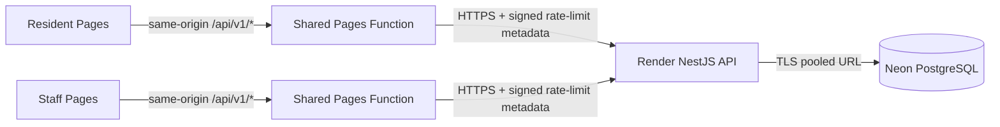

# Phase 5B deployment preparation (architecture reference)

This document records the approved Phase 5B architecture and free-tier limitations. Phase 5C has since been completed, and the owner reports that Phase 5D passed nine hosted functional checks. The current endpoints and guarded manual deployment procedure are in the [Phase 5E-A frontend deployment runbook](phase5e-a-frontend-deployment-runbook.md). This remains a demonstration-only system; it is not approved for real resident records. This review made no cloud changes and did not repeat the hosted workflow.



## Pages project layout

The two Vite applications remain separate builds. The single source Function is `functions/api/v1/[[path]].ts` at the repository root. Each app copies its `public/_routes.json` into `dist`; it includes only `/api/v1/*`. SPA fallback and static assets bypass the Function. `_headers` adds static security and asset caching rules, while the Function sets `Cache-Control: no-store` on every API response.

Cloudflare Pages expects a standard `wrangler.jsonc` at each Pages project root. Wrangler rejects custom `--config` paths for `pages dev`, so `wrangler.resident.jsonc` and `wrangler.staff.jsonc` are templates. The harness and `scripts/pages.sh` create a temporary Pages root, copy the selected template to `wrangler.jsonc`, copy the app output to `dist`, and copy the shared root `functions/` source. Both Function bundles are compiled from those isolated roots before the browser tests run.

From the frontend repository root:

```sh
npm --prefix frontend-website ci
npm --prefix frontend-admin ci
npm --prefix integration-e2e ci
bash scripts/pages.sh check resident
bash scripts/pages.sh check staff
npm --prefix integration-e2e run test:proxy
```

The local proxy suite uses a mock API, fake HMAC key, localhost-only ports, Chromium, and temporary files under `/tmp`. It checks both sites, static and nested-route fallback, forwarded headers/body, replaced forwarding metadata, HMAC payload agreement, multiple scoped cookies, cache prevention, and safe 5xx/transport errors. It does not establish hosted behavior.

The manual deployment workflow is now documented in the Phase 5E-A runbook. `scripts/pages.sh` checks the exact project name, dist path, HTTPS backend origin, explicit production override, and encrypted-secret name. It stages the shared Function beside the selected assets and runs Wrangler from that Pages root. Do not put Function secrets in Wrangler templates or any `VITE_` variable. Wrangler config is the source of truth for fields declared in the file; review dashboard settings against these configs before deployment.

The current Pages projects are `barangay-document-resident` and `barangay-document-staff`, with origins `https://barangay-document-resident.pages.dev` and `https://barangay-document-staff.pages.dev`. The backend must allow these exact origins in `CORS_ORIGINS`; CORS is not authorization. The active backend allowlist remains a backend/dashboard verification item.

## Environment variables

| Location | Name | Value or purpose |
| --- | --- | --- |
| Vite build, each app | `VITE_API_BASE_URL` | `/api/v1`; public same-origin path, no secret |
| Pages Function, each project | `API_ORIGIN` | Fixed HTTPS Render API origin, without credentials, path, query, or fragment |
| Pages Function, each project | `CLIENT_IP_HMAC_SECRET` | Same server-side base64 representation of a random 32-byte key used by the API |
| Render | `NODE_ENV` | `production` |
| Render | `NODE_VERSION` | `22.23.2`, matching the frontend repository's pinned CI/tooling version |
| Render | `PORT` | Supplied by Render; do not hard-code it |
| Render | `DATABASE_URL` | Neon pooled PostgreSQL URL with TLS for runtime traffic |
| Render | `IDEMPOTENCY_ENCRYPTION_KEY` | Existing random base64 32-byte application secret |
| Render | `CLIENT_IP_HMAC_SECRET` | Same random 32-byte key as both Pages Functions; production startup requires it |
| Render | `CORS_ORIGINS` | Exact resident and staff Pages origins, comma-separated |
| Render | `COOKIE_SECURE`, `COOKIE_SAME_SITE` | `true`, `lax` |
| Render | `TRUST_PROXY` | `false`; raw forwarding headers are not trusted |
| Render | `SESSION_TTL_HOURS`, `LOG_LEVEL` | `8`, `info` unless the operator approves otherwise |
| Migration workstation only | `NEON_DIRECT_URL` | Neon direct TLS URL, used temporarily as `DATABASE_URL` for controlled migration/backup; never committed |

The Vite production examples contain only `/api/v1`. Vite variables are embedded in public JavaScript and must not contain credentials.

## Request and authentication behavior

Both API clients use a 90-second timeout to allow for a Render Free service waking from idle. Render documents a typical wake of about a minute, not a guaranteed maximum. The Pages Function forwards bodies as streams and adds no retries. Resident mutations remain manual-retry only: an unresolved attempt keeps the exact serialized body and idempotency key in memory, and retry reuses both within the backend's 24-hour replay window. Reload recovery stores only a non-sensitive uncertainty timestamp. After the replay window, the UI requires an explicit new-attempt choice. Staff session restoration and logout reconciliation remain in the app.

The proxy forwards `Origin`, `Cookie`, `X-CSRF-Token`, `Idempotency-Key`, and `If-Match`; it strips hop-by-hop and browser-supplied forwarding/client-IP metadata. It preserves ETags, request IDs, and each `Set-Cookie` value. Backend cookies retain `HttpOnly`, `Secure`, `SameSite=Lax`, and `/api/v1/staff` scoping. The staff app calls its own Pages origin, so its cookie is first-party; the design does not rely on cross-site third-party cookies. Exact-Origin and CSRF checks remain in NestJS.

The Function signs a versioned newline-delimited payload containing Unix timestamp, Cloudflare edge IP, uppercase method, and URL pathname. The API checks a 32-byte HMAC secret, valid IP, method/path, and a 60-second time window with a timing-safe comparison. Verified IP is only the rate-limit tracker; it grants no identity, session, role, or authorization. Missing or invalid signatures fall back to Express `request.ip` with `TRUST_PROXY=false`; unsigned `Forwarded`, `X-Forwarded-For`, and `X-Real-IP` are ignored.

The timestamp narrows replay exposure but does not prevent replay. The signature binds timestamp, IP, method, and pathname; query strings and bodies are not signed. A captured signature can therefore attribute calls with the same method/path to that same IP bucket for up to 60 seconds, even if the query or body differs. That may consume the victim IP's rate-limit budget, but cannot change the signed IP/method/path or authenticate. The in-memory limiter resets on Render restarts and is not shared across replicas. Direct Render API calls have no Pages signature and use the transport-level `request.ip` fallback; endpoint authorization still applies.

## Render and Neon preparation

The backend's `render.yaml` prepares one Render Free Node service with `npm ci && npm run build` and `npm run start`. It pins Node.js 22.23.2 to match CI; Render's documented default can change over time. Render supplies `PORT`. The blueprint omits startup migrations and an HTTP health probe that repeatedly queries Neon. Keep the existing health endpoint for explicit checks. Render's free filesystem is ephemeral. Staff sessions remain in PostgreSQL and survive process restarts subject to expiry/revocation; the in-memory rate limiter resets.

Use Neon’s pooled TLS URL for runtime connections and its direct TLS URL only from a controlled migration/backup workstation. The Prisma schema is unchanged. The frontend repository does not apply migrations or connect to the cloud database.

For fictional demonstration data, periodically make an encrypted custom-format `pg_dump` outside Render, store the encryption key separately, and rehearse restores only into a fresh disposable `_test` database. Do not put dumps in source control, CI artifacts, or Render's ephemeral filesystem. Neon’s restore window is not an independent backup or production-grade recovery guarantee.

## Free-tier and operational boundaries

The target is `$0/month` only while accounts remain eligible and use stays within ongoing free allowances, no paid add-ons are selected, and billing cannot automatically charge. Inspect account-specific terms and billing settings before Phase 5C. If payment details are required and usage billing cannot be disabled, stop. A free plan provides no production availability or durability guarantee.

- Cloudflare Workers Free currently allows 100,000 combined Workers/Pages Function requests per day, 10 ms CPU per invocation, and 128 MB memory; static requests that bypass Functions are unlimited. Review fail-open/closed behavior for the account. [Limits](https://developers.cloudflare.com/workers/platform/limits/) · [Pages pricing](https://developers.cloudflare.com/pages/functions/pricing/)
- Render Free web services sleep after 15 minutes without inbound traffic and typically take about a minute to wake. Free instance hours are capped per workspace; the filesystem is ephemeral. Bandwidth/build usage may incur charges if a payment method is attached, while services can be suspended at limits without one. [Free services](https://render.com/docs/free) · [Billing FAQ](https://render.com/docs/faq)
- Neon Free currently lists 100 projects, 1 GB storage and 100 CU-hours per project per month, autoscaling up to 2 CU, and a six-hour instant-restore window. Verify the account and PostgreSQL version during any future controlled change. Scale-to-zero can add latency. [Free plan](https://neon.com/blog/neon-free-plan-1-gb-per-project) · [Prisma](https://neon.com/blog/better-postgres-with-prisma-experience)

The 90-second browser timeout exceeds the documented typical Render wake, not every possible cold start. Cloudflare documents no hard wall-clock limit for an incoming HTTP-triggered Worker while the client remains connected; the 10 ms Free limit is CPU time, so waiting on the proxied fetch does not consume that CPU allowance. A disconnected browser or runtime interruption can still cancel an in-flight request. Network/provider/browser timeouts can also end a request earlier. Resident timeout handling must preserve uncertainty and never silently create a replacement idempotency key. Local mocks cannot prove Render startup timing or hosted cookie behavior. [Cloudflare Worker limits](https://developers.cloudflare.com/workers/platform/limits/)

## CI and operational approval gate

The existing frontend, accessibility, and database-gated integration jobs remain. A separate `pages-proxy` job builds both Vite apps, compiles the shared Function from isolated Pages roots, and runs the mock-only Chromium suite without PostgreSQL or Cloudflare credentials. The existing backend revision stays pinned; intentionally synchronize it only after reviewing a backend commit.

The current deployments are for controlled demonstration use. Any future frontend deployment remains manual and requires the exact project name, verified production branch, encrypted-secret preflight, and explicit approval variables. Do not use real resident/staff records. DNS, unattended deployment, and public-service use require separate approval and readiness review.

Free-tier rollback cannot restore data beyond the provider recovery window without independent backup. Before public operation, the barangay must approve data definitions, retention/deletion, access controls, incident response, backup ownership, recovery targets, and availability/budget requirements. This is demonstration preparation, not public-service readiness.
