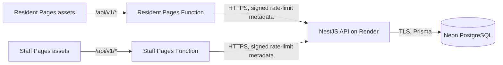

# Phase 5E-A — Frontend Deployment Hardening and Handoff

## Scope and status

This runbook covers only this frontend repository. The resident and staff sites are deployed on Cloudflare Pages and call the separately hosted NestJS API through same-origin Pages Functions. The owner reports that Phase 5D passed nine hosted functional checks, including the resident request/tracking lifecycle and staff login, session restoration, and protected-route checks. This review did not rerun those hosted workflows and made no Cloudflare, Render, DNS, or database changes.

The deployment is for demonstration and controlled testing with fictional records. It is not approved for real barangay operations or real resident information.

| Service | Current demonstration URL |
| --- | --- |
| Resident site | <https://barangay-document-resident.pages.dev> |
| Staff portal | <https://barangay-document-staff.pages.dev> |
| NestJS API | <https://barangay-document-request-system-backend.onrender.com> |



## Repository and configuration review

`frontend-website` and `frontend-admin` remain separate Vite applications, each with its own lockfile, build output, and Pages project. Both `public/_routes.json` files invoke Functions only for `/api/v1/*`; static assets are excluded from Function routing and SPA paths fall through to `index.html`. The shared Function lives at repository root in `functions/api/v1/[[path]].ts`. `scripts/pages.sh` stages the selected app's `dist`, the shared `functions/`, and its Wrangler config into a temporary Pages root before running Wrangler from that root.

The Wrangler project names match the current Pages project names. Each config declares `API_ORIGIN` at the shared scope for local/preview use and explicitly under `env.production.vars` for production. It is the public HTTPS origin only; credentials, paths, queries, and fragments are rejected by the deployment check. Wrangler configuration is authoritative for fields declared there, so keep dashboard settings aligned and review any configuration changes before deployment. Cloudflare documents both the source-of-truth behavior and the production branch option in its [Pages Wrangler configuration guide](https://developers.cloudflare.com/pages/functions/wrangler-configuration/).

| Name | Where it belongs | Value or rule |
| --- | --- | --- |
| `VITE_API_BASE_URL` | Frontend build | Production build is forced to `/api/v1`; local `.env.example` points to the local backend. It is public build configuration. |
| `API_ORIGIN` | Wrangler `vars` | The fixed Render HTTPS origin, with no path or credentials. It is repeated under `env.production.vars`. |
| `CLIENT_IP_HMAC_SECRET` | Cloudflare encrypted Pages secret, separately set for both projects | Same base64 encoding of the 32-byte key configured in the backend. Never put it in Wrangler `vars`, Vite variables, or source-controlled environment files. |
| `CLOUDFLARE_API_TOKEN` | Optional deploy-time process environment | Use a narrowly scoped token for Pages deploy and secret-list access. Do not save it in this repository or pass it to a Vite build. |

The production `.env.production.example` files contain only `VITE_API_BASE_URL=/api/v1`. They were previously hidden by the broad `.env.*` ignore rule; the root ignore file now explicitly allows these examples while continuing to ignore actual `.env` files. Wrangler's `.wrangler/` local state is ignored.

The deployment script sets `VITE_API_BASE_URL=/api/v1` directly on the Vite build command. That process value takes precedence over shell exports and `.env*` files, preventing a local or CI environment override from compiling a direct backend URL into the production site.

## Local prerequisites and checks

Use Node.js `22.23.2` from `.nvmrc`. From the repository root:

```sh
npm --prefix frontend-website ci
npm --prefix frontend-admin ci
npm --prefix integration-e2e ci

npm --prefix frontend-website test
npm --prefix frontend-website run typecheck
npm --prefix frontend-website run lint
npm --prefix frontend-website run build

npm --prefix frontend-admin test
npm --prefix frontend-admin run typecheck
npm --prefix frontend-admin run lint
npm --prefix frontend-admin run build

npm --prefix integration-e2e run test:proxy
bash scripts/pages.sh check resident
bash scripts/pages.sh check staff
```

`test:proxy` and the `check` commands use local Wrangler packaging and mocked upstream behavior. They do not require Cloudflare credentials or a database. The full-stack Playwright suite is database-changing and belongs only in its existing isolated `_test` database gate; this frontend deployment runbook does not run it.

## Manual deployment procedure

Deployments are not triggered by CI. Before a manual deployment:

1. In the selected Pages project's dashboard, confirm the exact project name and its configured production branch. Do not assume the branch is `main`.
2. In the dashboard, confirm `CLIENT_IP_HMAC_SECRET` is present as an encrypted secret for the **Production** environment in each Pages project. The script's `wrangler pages secret list` check is project-level (the pinned CLI has no environment selector), so it only catches an absent project secret name; it cannot prove that the production binding is configured. The check never prints a secret value. Cloudflare secrets are encrypted bindings accessible to the Function through `context.env`; set them before deploying. See [Pages environment variables and secrets](https://developers.cloudflare.com/pages/functions/bindings/).
3. Use a Wrangler login or a short-lived, least-privilege Cloudflare API token in the process environment. For a custom Wrangler login directory, set `XDG_CONFIG_HOME` explicitly. Check the current backend CORS allowlist in the backend environment/configuration review; it must include the two exact Pages origins.
4. Run the local packaging check first. Then deploy only after intentionally setting all three confirmation inputs: approval, exact project name, and the verified production branch.

Example for the resident site (replace `main` only with the branch verified in that Pages project's settings):

```sh
bash scripts/pages.sh check resident
PAGES_DEPLOY_APPROVED=YES \
PAGES_DEPLOY_PROJECT=barangay-document-resident \
PAGES_PRODUCTION_BRANCH=main \
bash scripts/pages.sh deploy resident
```

For staff, use `check staff`, `PAGES_DEPLOY_PROJECT=barangay-document-staff`, and `deploy staff`. The script passes `--project-name` and `--branch` explicitly, verifies the project name against the selected config, validates both shared and production API origins, rejects a plaintext HMAC secret, and checks that the encrypted secret name is present. The secret-list response is captured and suppressed. A deploy is a remote side effect; do not set `PAGES_DEPLOY_APPROVED=YES` for routine checks.

## Post-deployment verification

After an intentional deployment, verify each site independently:

```sh
curl -i https://barangay-document-resident.pages.dev/api/v1/document-types
curl -i https://barangay-document-staff.pages.dev/api/v1/document-types
curl -i https://barangay-document-staff.pages.dev/api/v1/staff/auth/me
```

The catalog routes should return the backend's public catalog response with `Cache-Control: no-store`; the unauthenticated staff session route should return the expected 401. A request ID may be present. Do not include private request data, cookies, tracking credentials, or session tokens in diagnostics.

Also open a nested resident route directly (for example `/track`) and a nested staff route directly in a browser to confirm SPA fallback; check a static asset response for long-lived immutable caching and the HTML response for `no-cache`. Confirm browser API requests use each Pages origin, the staff cookie remains HttpOnly/Secure/SameSite=Lax and scoped to `/api/v1/staff`, and login, logout, CSRF, and session restoration work. Use only the existing fictional demo records; do not submit new records during routine config checks.

## Security and reliability review

- **Same-origin proxy:** The Function accepts only a fixed HTTPS origin (local HTTP is limited to loopback in explicit local test mode), builds the upstream URL from the incoming path/query and that fixed origin, and strips hop-by-hop, forwarding, and client-IP headers supplied by the browser. It forwards the original `Origin`, cookies, CSRF, idempotency, and `If-Match` headers. It does not log request bodies or credentials.
- **Client IP metadata:** The Function signs the Cloudflare edge IP, timestamp, uppercase method, and path using HMAC. The backend uses verified metadata only for rate-limit attribution. It is not an identity or authorization credential. A missing Pages secret causes unsigned fallback behavior; invalid configured key material produces a generic 503. Direct API requests remain protected by backend authorization and its transport-IP fallback.
- **Cookies and CSRF:** Staff uses same-origin `credentials: include`; the proxy preserves each `Set-Cookie` value and does not rewrite backend cookie security attributes. CSRF stays in memory and is sent on mutations. Exact-Origin checks and authorization remain backend responsibilities.
- **Private data and caching:** Every Function response receives `Cache-Control: no-store` and `Pragma: no-cache`, including errors. Tracking credentials stay in tab memory; session storage stores only a timestamped uncertainty marker. The new static CSP permits scripts, styles, API connections, and other resources only from the current origin (with `data:` allowed for images/fonts); `frame-ancestors 'none'` complements the existing frame header.
- **Retry behavior:** Both clients use a 90-second timeout. Queries can retry once; mutations do not retry automatically. A resident uncertain submission retains its exact body and idempotency key for explicit same-key retry inside the backend replay window. After reload, the app warns and requires acknowledgement before a new attempt. Staff API writes are also not automatically retried; stale ETag/`If-Match` failures refresh the affected request.
- **Free-tier limits:** Cloudflare Workers Free currently allows 100,000 shared Worker/Pages Function requests per day, 10 ms CPU and 128 MB memory; static requests that bypass Functions are unlimited. [Cloudflare limits](https://developers.cloudflare.com/workers/platform/limits/) · [Pages Function pricing](https://developers.cloudflare.com/pages/functions/pricing/). Render Free sleeps after 15 minutes idle and takes about a minute to wake; its filesystem is ephemeral and included usage is capped. [Render Free services](https://render.com/docs/free). Neon Free currently lists 1 GB storage, 100 CU-hours per project per month, autoscaling up to 2 CU, and a six-hour instant-restore window. [Neon Free plan](https://neon.com/blog/neon-free-plan-1-gb-per-project). These plans provide no production availability or durable-backup guarantee; recheck current account limits and billing settings.

The 90-second timeout accommodates Render's typical wake, not every delay. A transport failure can still leave a mutation's outcome uncertain; the app's recovery safeguards must remain intact. Do not add keep-alive traffic to defeat free-tier sleep.

## Diagnosis and rollback

| Symptom | Safe first checks |
| --- | --- |
| Pages Function returns sanitized 503 | Confirm `API_ORIGIN` exists in the selected project's production config and is the exact HTTPS origin. Check the HMAC secret binding name and deployment tail category; never print its value. A 503 can also represent an upstream 5xx that the Function sanitizes. |
| Proxy returns 502 | Check Render availability and Pages invocation logs for transport failure; the Function does not expose upstream internal details. |
| API calls go directly to Render from the browser | Rebuild through `scripts/pages.sh`; it forces `/api/v1`. Inspect the compiled asset for configuration drift without publishing it. |
| Staff login/session or mutation fails | Check the exact forwarded `Origin`, encrypted session cookie, CSRF token lifecycle, backend CORS allowlist, and `If-Match`/ETag behavior. Do not relax cookie, CSRF, or authorization settings. |
| Slow first request after inactivity | Allow for Render wake-up. A browser timeout does not prove the backend did not process a mutation. Use the resident same-key retry flow; do not submit a new request silently. |

For a bad Pages release, use the Pages dashboard's rollback to the last known-good deployment for that project, then verify its API route and nested SPA route. Resident and staff rollbacks are independent. A frontend rollback does not reverse API/database changes; those require a separate backend/database recovery plan. Keep a known-good deployment available and do not rely on free database instant restore as a durable backup.

## Phase 5E-B handoff

No frontend API-contract or authentication change is proposed. The backend review should reconfirm exact `CORS_ORIGINS`, HMAC key agreement and verification, database-backed session expiry/revocation, privacy-safe logs, database recovery procedures, and the fact that the in-memory rate limiter resets on Render restart and is not shared across replicas. Those are backend/operations checks; this frontend repository does not change backend code or database state.
